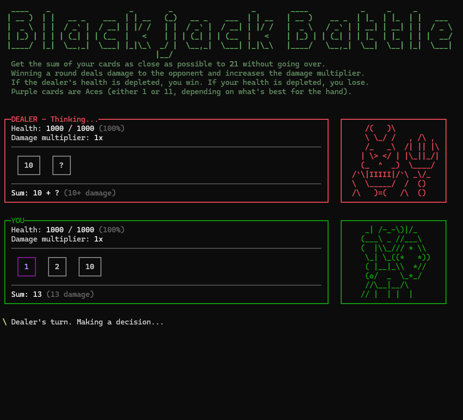

# Blackjack Battle

**Blackjack Battle** is a game created as a C# console application with the **JetBrains Rider** IDE and the **[Spectre.Console](https://spectreconsole.net)** library for nicer console output.

The project is a school assignment for a C# introduction course. Our instructions were to create a blackjack game with basic rules. I decided to take it in another direction where you battle the dealer to the death.

## About the game
- Your goal is to defeat the dealer by depleting their health. Their goal is to defeat you.
- You strike the dealer when you win a round (by gaining the highest card sum without going over 21). Damage dealt equals your card sum multiplied by your damage multiplier.
- Choose an appropriate action each turn. Get more cards, stay at your current card sum, or choose to double down (deal and take double damage for one round).
- Every time you win a round, your damage multiplier will increase. This will significantly increase your damage.